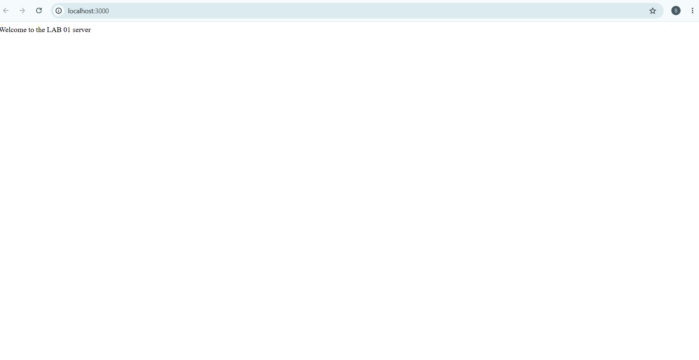
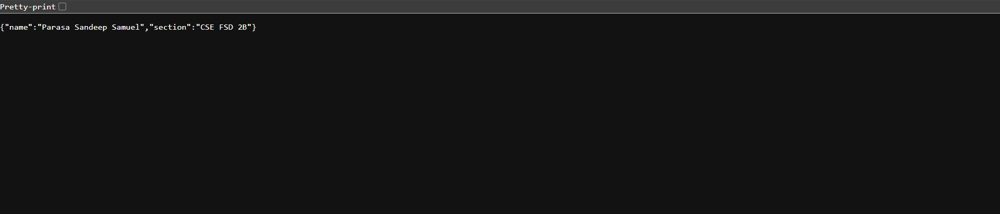
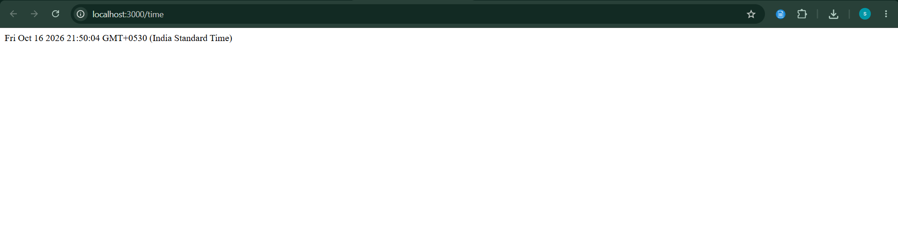

# Lab 1: Node.js and Express server

**Name:** Parasa Sandeep Samuel
**Registration Number:** 252U1R076
**Section:** CSE FSD 2B
**Course:** Backend Development Fundamentals

## Live Link

"https://backend-development-fundamentals-lab-01-qkee.onrender.com/"

The service runs on Render's free plan, which sleeps after 15 minutes without traffic. The first request after a pause can take about a minute.

## Objective

Set up a Node.js project and build a small web server, first with the built-in `http` module and then with Express.

## How to Run

Requirements: Node.js and npm. No environment variables are needed. The server reads `PORT` if it is set and uses 3000 otherwise.

```
cd lab-01
npm install
npm run dev
```

Open `http://localhost:3000` in the browser.

To run the plain `http` module version instead (stop the other server first, since both use port 3000):

```
node server-http.js
```

## package.json Fields

| Field | Meaning |
| --- | --- |
| name | Name of the project |
| version | Current version of the project |
| description | Short description of the project |
| main | Entry file of the project |
| scripts | Commands that can be run with `npm run`, for example `npm run dev` |
| author | Person who wrote the project |
| license | License the project is shared under |
| dependencies | Packages the project needs, here `express` |

`npm install express` downloads Express into the `node_modules/` folder and records it under `dependencies`. `node_modules/` is not committed to Git.

## Endpoints

| Method | Path | Description | Status |
| --- | --- | --- | --- |
| GET | `/` | Returns welcome text | 200 |
| GET | `/about` | Returns JSON with name and section | 200 |
| GET | `/time` | Returns the current date and time | 200 |
| GET | any other path | Returns a 404 message | 404 |

## Status Codes Observed

| Route | Status code |
| --- | --- |
| `/` | 200 OK |
| `/about` | 200 OK |
| `/time` | 200 OK |
| `/anything` | 404 Not Found |

## Screenshots

### Home route



### About route



### Time route



### Unknown route (404)


## Notes

Problems faced and how I solved them:
I Found it tough while uploading screenshots and pushing commits in github, It was new to me.
