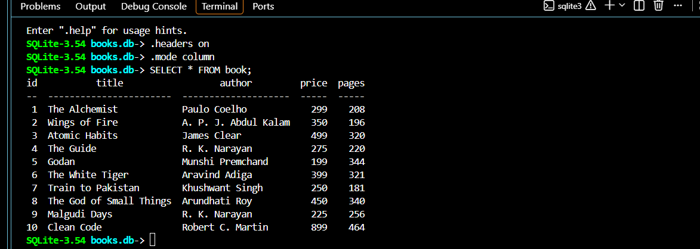
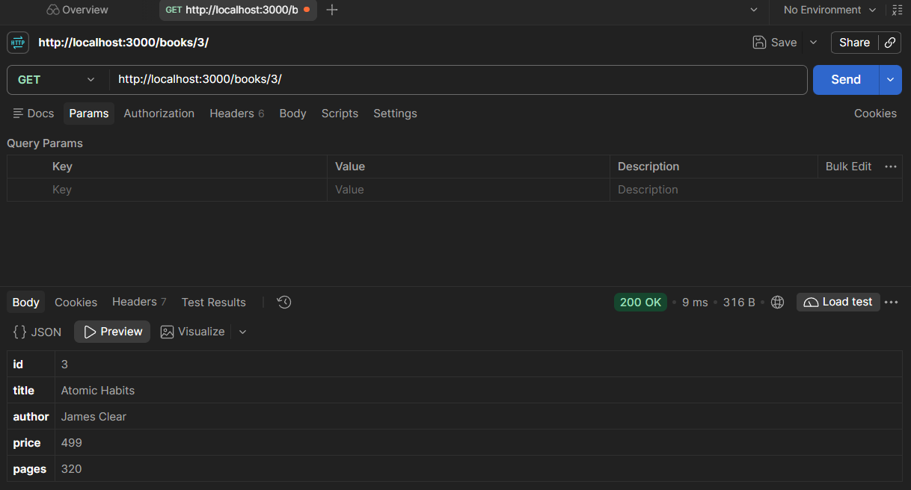
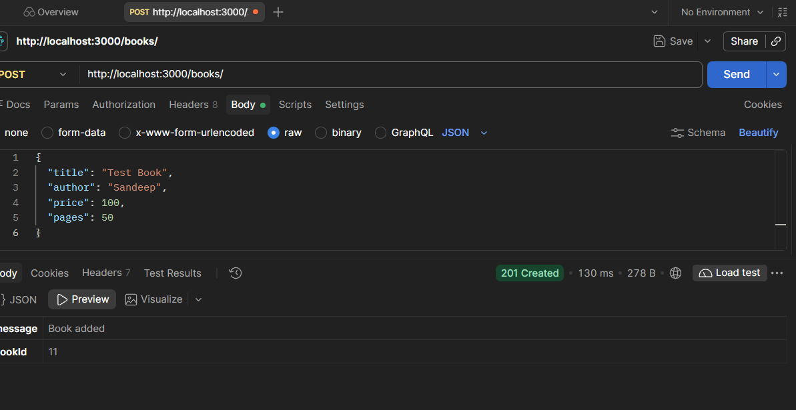
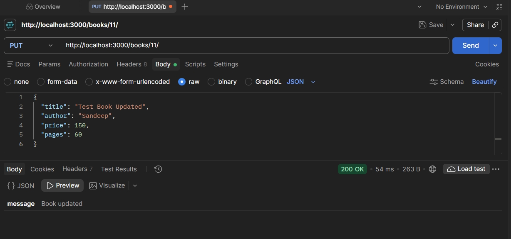
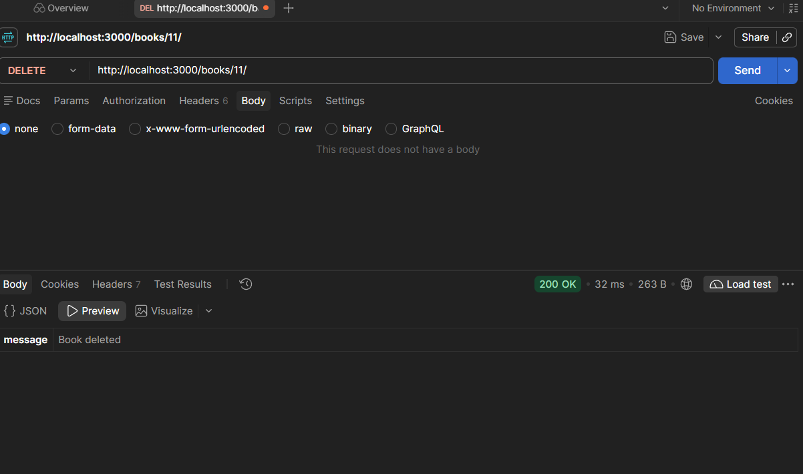
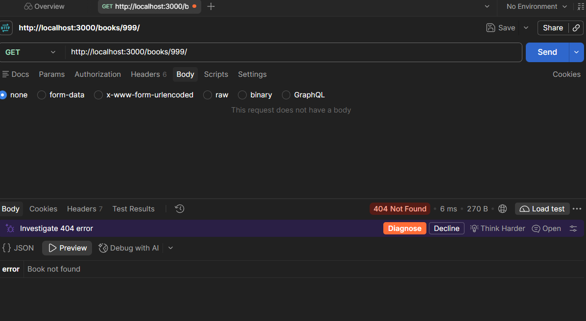
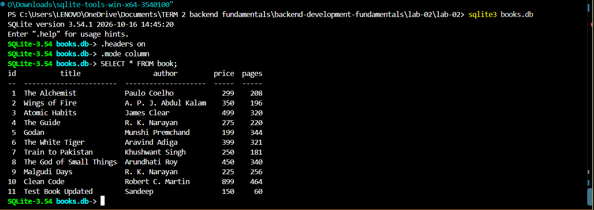

# Lab 2: SQLite database and CRUD routes

**Name:** Parasa Sandeep Samuel
**Registration Number:** 252U1R076
**Section:** CSE FSD 2B
**Course:** Backend Development Fundamentals

## Live Link
backend-development-fundamentals-1x8oln28l-sanjaysamuel333-8237.vercel.app


The service runs on VERCEL's free plan, which sleeps after 15 minutes without traffic, so the first request can take about a minute. The free plan also does not keep files between restarts, so any books added, changed or deleted through the live link are lost when the service restarts and the database returns to the 10 starting rows.

## Objective

Connect an Express server to a SQLite database and expose create, read, update and delete operations over HTTP.

## How to Run

Requirements: Node.js and npm. No environment variables are required. The server reads `PORT` if it is set and uses 3000 otherwise.

```
cd lab-02
npm install
npm start
```

To restart the server automatically on every change while developing:

```
npm run dev
```

Packages used: `express`, `sqlite`, `sqlite3`, and `nodemon` (development only).

## Database

The database file is `books.db` and it holds one table:

```
book(id INTEGER PRIMARY KEY, title TEXT, author TEXT, price INTEGER, pages INTEGER)
```

`seed.sql` contains the table definition and the 10 starting rows. To rebuild the database from scratch with the SQLite CLI:

```
sqlite3 books.db < seed.sql
```

To inspect it:

```
sqlite3 books.db
.headers on
.mode column
SELECT * FROM book;
```

## Endpoints

| Method | Path | Description | Success status |
| --- | --- | --- | --- |
| GET | `/books/` | Returns all books | 200 |
| GET | `/books/:bookId/` | Returns one book | 200 |
| POST | `/books/` | Adds a new book from the JSON body | 201 |
| PUT | `/books/:bookId/` | Updates all fields of an existing book | 200 |
| DELETE | `/books/:bookId/` | Deletes a book | 200 |

Request body for POST and PUT:

```
{
  "title": "Book title",
  "author": "Author name",
  "price": 299,
  "pages": 208
}
```

Error responses:

| Case | Status |
| --- | --- |
| `bookId` is not a positive whole number | 400 |
| Missing or invalid field in the body, or malformed JSON | 400 |
| No book with that id (GET one, PUT, DELETE) | 404 |
| Unknown route | 404 |

Every query that uses input from the request uses `?` placeholders.

## Screenshots

### Database before testing (SQLite CLI)



### GET all books


### GET one book



### POST add a book



### PUT update a book



### DELETE a book



### Error case: book not found (404)



### Database after testing (SQLite CLI)




