# Lab 3: REST API, query parameters, validation, debugging

**Name:** Parasa Sandeep Samuel
**Registration Number:** 252U1R076
**Section:** CSE FSD 2B
**Course:** Backend Development Fundamentals

## Live Link

[ADD YOUR RENDER URL HERE]

The service runs on Render's free plan, which sleeps after 15 minutes without traffic, so the first request can take about a minute. The free plan also does not keep files between restarts, so books added, changed or deleted through the live link are lost when the service restarts and the database returns to the 10 starting rows.

## Objective

Turn the Lab 2 routes into a clean REST API with search, sorting, pagination, a price filter, validation and consistent status codes and error messages, and practise debugging common errors.

## How to Run

Requirements: Node.js and npm. No environment variables are required. The server reads `PORT` if it is set and uses 3000 otherwise.

```
cd lab-03
npm install
npm start
```

To restart automatically on every change while developing:

```
npm run dev
```

Packages used: `express`, `sqlite`, `sqlite3` (pinned to 5.1.7 so it runs on Render), and `nodemon` (development only).

The database file is `books.db` with the table `book(id INTEGER PRIMARY KEY, title TEXT, author TEXT, price INTEGER, pages INTEGER)`. `seed.sql` rebuilds it with the 10 starting rows.

## Endpoints

Endpoints are nouns (`/books`) and the HTTP method shows the action.

| Method | Path | Description | Success status |
| --- | --- | --- | --- |
| GET | `/books/` | Lists books, with search, sort, pagination and price filter | 200 |
| GET | `/books/:bookId/` | Returns one book | 200 |
| POST | `/books/` | Adds a book from the JSON body | 201 |
| PUT | `/books/:bookId/` | Replaces all fields of an existing book | 200 |
| DELETE | `/books/:bookId/` | Deletes a book | 200 |

### Query parameters for GET /books/

| Parameter | Meaning | Default | Allowed values |
| --- | --- | --- | --- |
| `search_q` | Partial, case-insensitive title match (`LIKE`) | empty (all titles) | any text |
| `order_by` | Column to sort by | `id` | `id`, `title`, `author`, `price`, `pages` |
| `order` | Sort direction | `ASC` | `ASC`, `DESC` |
| `limit` | Number of books to return | 10 | whole number from 1 to 100 |
| `offset` | Number of books to skip | 0 | whole number, 0 or more |
| `min_price` | Lowest price to include | 0 | whole number, 0 or more |
| `max_price` | Highest price to include | 2147483647 | whole number, 0 or more |

Example: `/books/?search_q=the&min_price=200&max_price=500&order_by=price&order=DESC&limit=5&offset=0`

All values are passed to SQLite with `?` placeholders. The sort column cannot be a placeholder, so `order_by` is checked against a fixed list of column names and anything else is rejected with 400.

### Request body for POST and PUT

```
{
  "title": "Book title",
  "author": "Author name",
  "price": 299,
  "pages": 208
}
```

`title` and `author` must be non-empty text. `price` and `pages` must be whole numbers, zero or more. A price sent as text, such as `"abc"`, is rejected.

### Responses and status codes

Every error response has the same shape: `{ "message": "..." }`.

| Situation | Status |
| --- | --- |
| Book created | 201 |
| Read, update or delete succeeded | 200 |
| Bad input: missing or invalid body field, bad id, bad query parameter, malformed JSON | 400 |
| Book id does not exist, or unknown route | 404 |

## Postman Tests

The file `lab-03.postman_collection.json` holds 30 requests with automatic checks on the status code and the message. To run it: import the file into Postman, set the collection variable `baseUrl` (default `http://localhost:3000`, or the Render URL), then use **Run collection**. The request that creates a book saves its id so the update, read and delete requests that follow use it.

### Success cases

| # | Test | Request | Expected status |
| --- | --- | --- | --- |
| 01 | GET all books (defaults: limit 10) | `GET /books/` | 200 |
| 02 | GET one book | `GET /books/3/` | 200 |
| 03 | Search by title (search_q=the) | `GET /books/?search_q=the` | 200 |
| 04 | Sort by price descending | `GET /books/?order_by=price&order=DESC&limit=5` | 200 |
| 05 | Pagination (limit=3, offset=3) | `GET /books/?limit=3&offset=3` | 200 |
| 06 | Price range (min_price=250, max_price=400) | `GET /books/?min_price=250&max_price=400` | 200 |
| 07 | All filters together | `GET /books/?search_q=r&min_price=200&max_price=500&order_by=pages&order=DESC&limit=2&offset=1` | 200 |
| 08 | SQL injection text in search is harmless | `GET /books/?search_q=%27%20OR%201%3D1%20--` | 200 |
| 09 | POST create a book | `POST /books/` | 201 |
| 10 | PUT update the new book | `PUT /books/{{newBookId}}/` | 200 |
| 11 | GET the updated book | `GET /books/{{newBookId}}/` | 200 |
| 12 | DELETE the new book | `DELETE /books/{{newBookId}}/` | 200 |

### Failure cases

| # | Test | Request | Expected status |
| --- | --- | --- | --- |
| 13 | GET book that does not exist | `GET /books/999/` | 404 |
| 14 | GET with non-numeric id | `GET /books/abc/` | 400 |
| 15 | GET after delete returns 404 | `GET /books/{{newBookId}}/` | 404 |
| 16 | DELETE same book again | `DELETE /books/{{newBookId}}/` | 404 |
| 17 | PUT book that does not exist | `PUT /books/999/` | 404 |
| 18 | POST missing title | `POST /books/` | 400 |
| 19 | POST missing author | `POST /books/` | 400 |
| 20 | POST non-numeric price | `POST /books/` | 400 |
| 21 | POST negative price | `POST /books/` | 400 |
| 22 | POST malformed JSON | `POST /books/` | 400 |
| 23 | PUT with invalid body | `PUT /books/1/` | 400 |
| 24 | Invalid order_by | `GET /books/?order_by=hack` | 400 |
| 25 | Invalid order | `GET /books/?order=SIDEWAYS` | 400 |
| 26 | limit is zero | `GET /books/?limit=0` | 400 |
| 27 | limit is not a number | `GET /books/?limit=abc` | 400 |
| 28 | negative offset | `GET /books/?offset=-1` | 400 |
| 29 | min_price greater than max_price | `GET /books/?min_price=500&max_price=100` | 400 |
| 30 | Unknown route | `GET /shelves/` | 404 |

## Screenshots

### Search by title

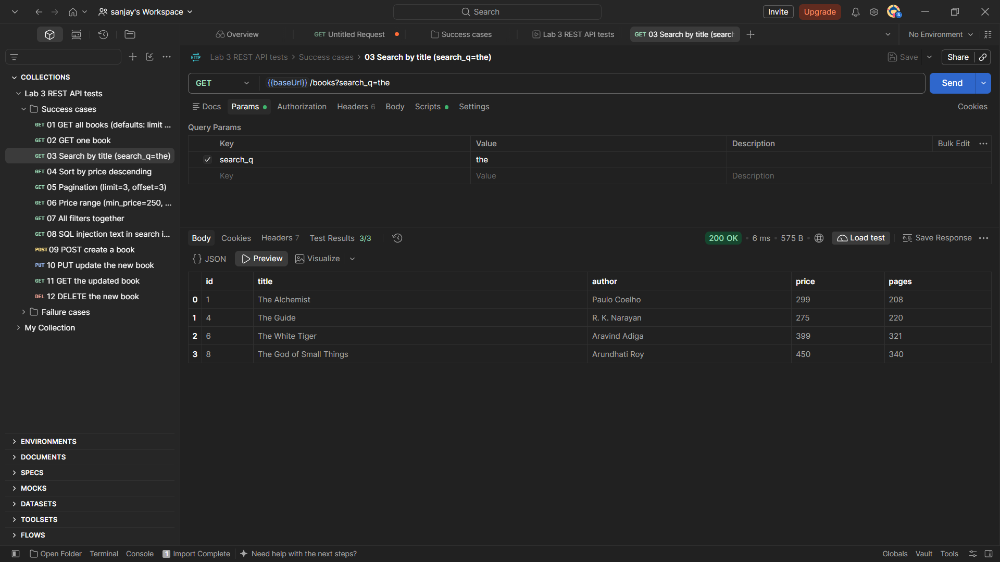

### Sort by price, descending

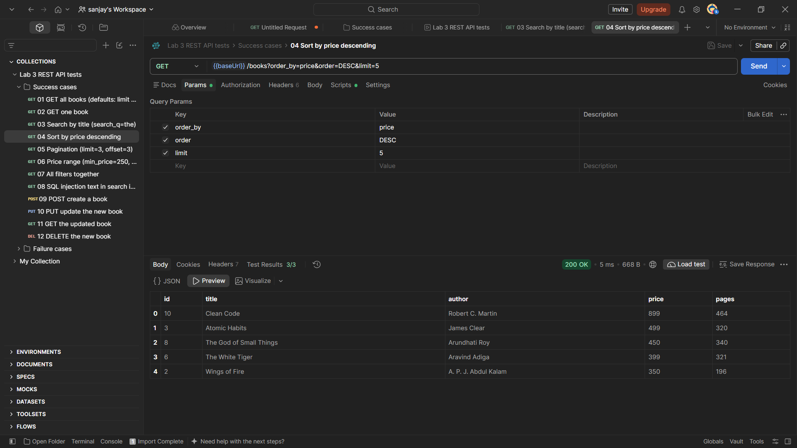

### Pagination

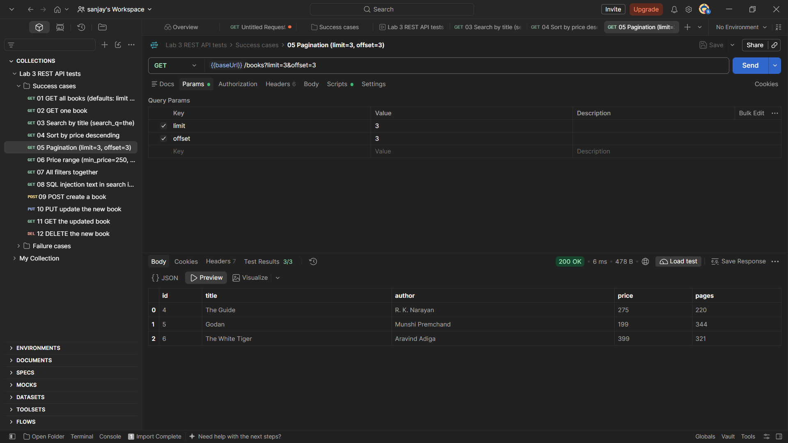

### Price range filter

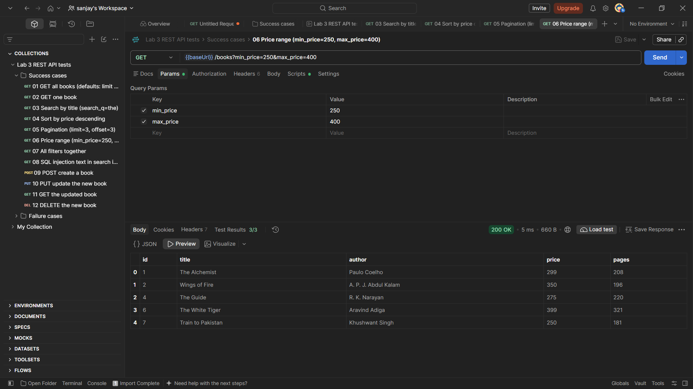

### POST creates a book (201)

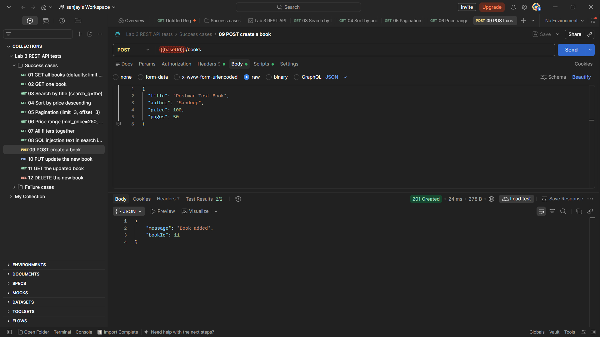

### PUT updates a book (200)

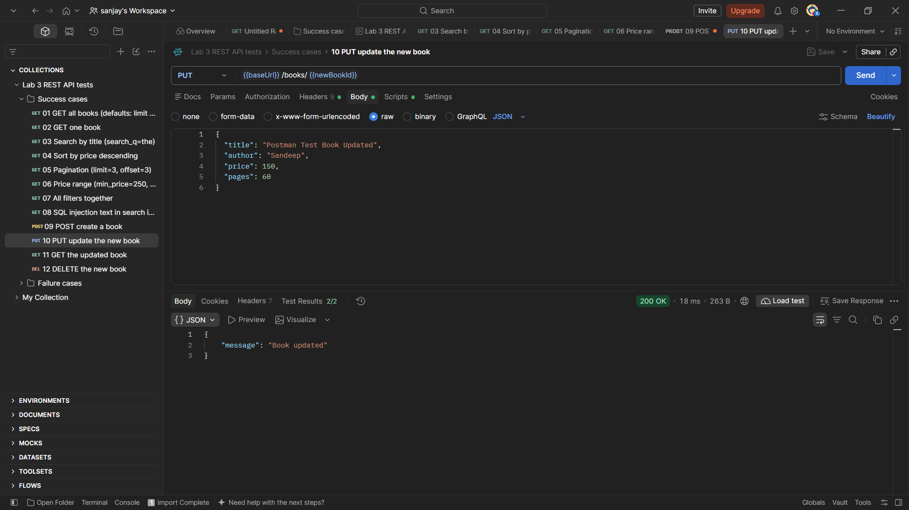

### DELETE removes a book (200)

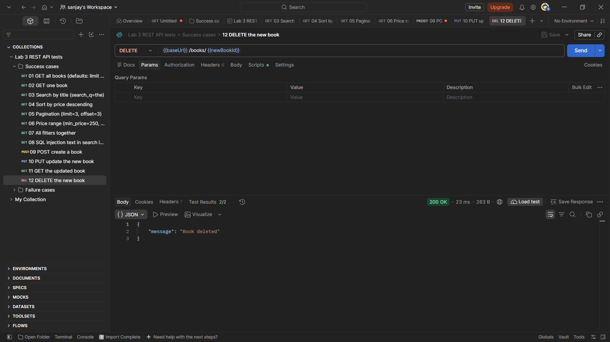

### Validation error: missing title (400)

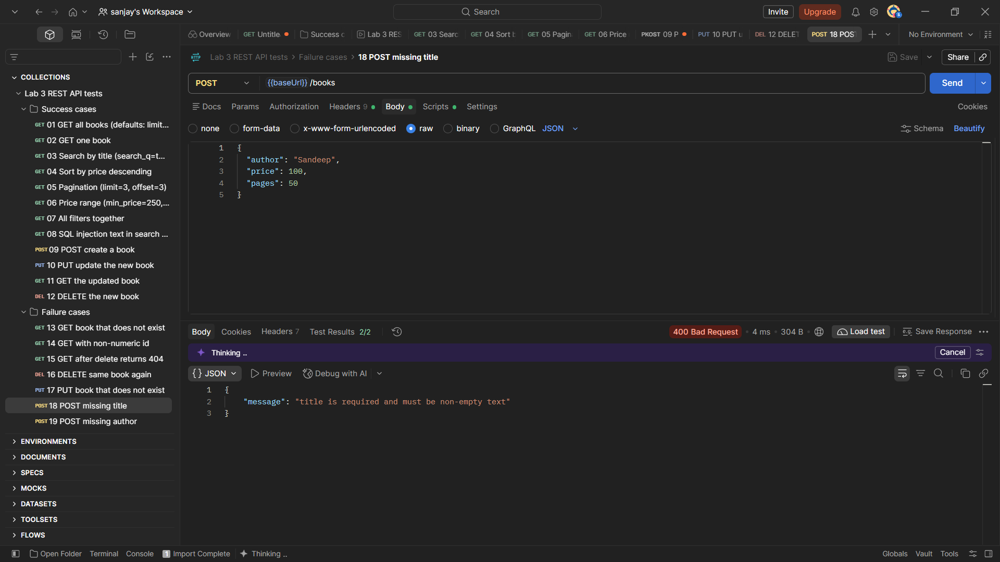

### Validation error: non-numeric price (400)

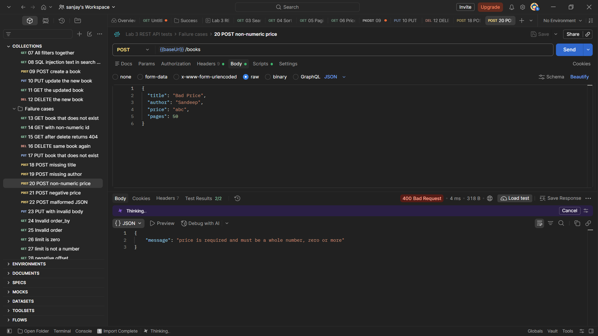

### Book not found (404)

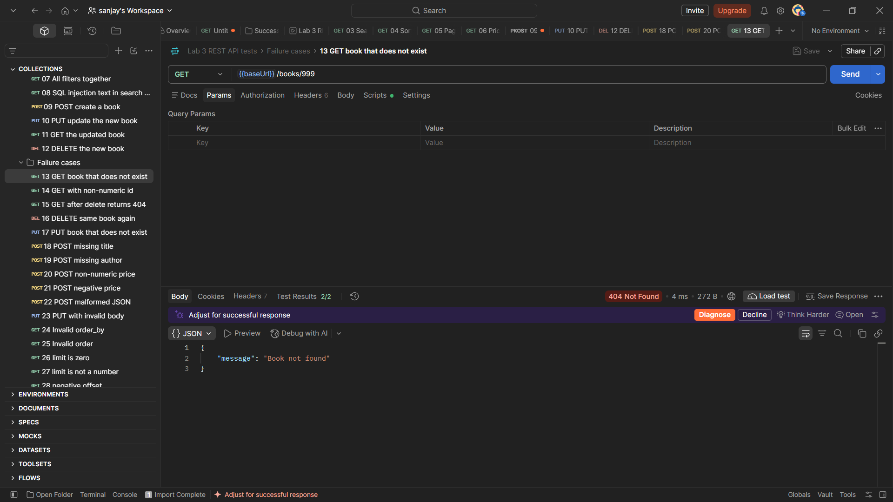

### All 30 Postman tests passing

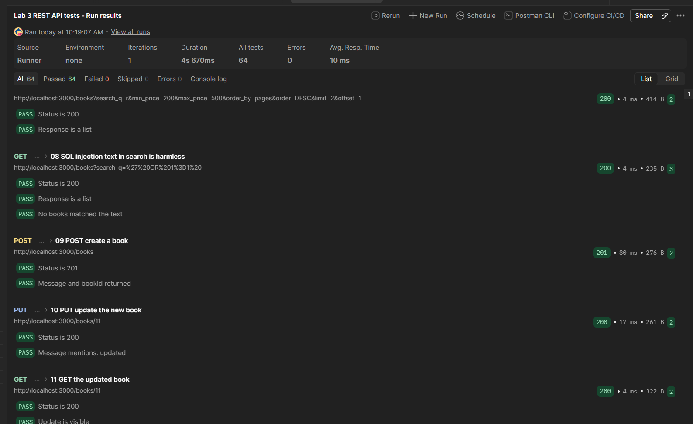

## Debugging Exercise

The broken version of the project was handed out by the faculty. The four errors I fixed:

| Error | Message I saw | Cause | Fix |
| --- | --- | --- | --- |
| Port conflict |Error: listen EADDRINUSE: address already in use :::3000 | Another copy of the server (or another app) is already using that port | Stop the old process (Ctrl+C in the other terminal), or change the port |
| Wrong import path | Error: Cannot find module './pathh' followed by a Require stack listing the file | A require("./...") points to a file or folder name that doesn’t exist | Correct the path and spelling, and check the file’s real name |
| Table name typo | SQLITE_ERROR: no such table: boook in the terminal, and a 500 from the route| The SQL names a table that isn’t in the database |Fix the table name to match, which you can check with .tables in the SQLite CLI |
| Missing await | The route returns {} with status 200, and no error in the terminal. Even a missing id returns 200 | The database call returns a Promise, and without await the code uses the Promise itself instead of the rows | Add await before the db.get, db.all or db.run call |


